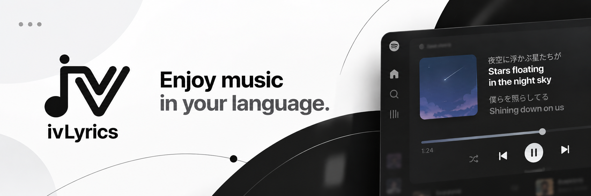

[한국어](README.md) · [English](README_EN.md)

# ivLyrics

Enjoy music in your language.

Read lyrics, follow the pronunciation, and understand the meaning inside Spotify on your PC. Choose the combination of original lyrics, pronunciation, and translation that works for you, then make the screen your own—from a quiet lyrics view to video backgrounds and a vinyl player.

[Get started](#get-started) · [Latest release](https://github.com/ivLis-Studio/ivLyrics/releases/latest) · [Get help](https://discord.gg/2fu36fUzdE)

https://github.com/user-attachments/assets/8375c5af-ae42-4f32-b138-47a8c15fa1e7

## Make more of the songs you love

- **Sing along in another language.** Show pronunciation guides and Japanese furigana.
- **Understand what you are hearing.** Read a translation alongside the lyrics, with optional cultural context, Research, and Learning features through compatible AI providers.
- **Set the mood.** Choose fullscreen, TV, or vinyl layouts, album artwork, and video backgrounds.
- **Make the text comfortable.** Adjust fonts, sizes, and colors separately for the original, pronunciation, and translation layers, and tune the screen's motion effects.
- **Fix lyrics that run early or late.** Adjust a song's timing or use community sync data.

Lyrics and timing availability depend on the song and provider. AI-generated translations, pronunciation, and explanations can be incorrect.

## Choose the right ivLyrics

This guide is for **Spotify desktop on Windows, macOS, and Linux**. Use the dedicated apps on mobile.

| Where or how you want to listen | What to use |
| --- | --- |
| Lyrics inside Spotify on your PC | **ivLyrics** — install below |
| Lyrics on Android | [ivLyrics Android](https://github.com/ivLis-Studio/ivLyrics-Android) |
| Lyrics on iPhone or iPad | [ivLyrics iOS](https://github.com/ivLis-Studio/ivLyrics-IOS) |
| Lyrics floating above other windows | [Overlay](https://github.com/ivLis-Studio/ivLyrics-overlay) — optional companion |
| Video playback assistance or external app integrations | [Helper](https://github.com/ivLis-Studio/ivLyrics-helper) — only for the features you need |

You do not need to install every companion or run a server to use the basic lyrics screen.

## Get started

### 1. Prepare Spotify and Spicetify

You need the Spotify desktop app and [Spicetify](https://spicetify.app/docs/getting-started). Check that Spotify can play music before continuing.

On Linux, also install Bash, `curl`, `unzip`, and either `sha256sum` or `shasum` for file verification.

If you just installed Spicetify, close and reopen PowerShell or your terminal. These commands are not for the web player or mobile apps.

### 2. Install ivLyrics

Run the command for your operating system. The same command also updates an existing installation.

**Windows — PowerShell**

```powershell
iwr -useb https://raw.githubusercontent.com/ivLis-Studio/ivLyrics/main/updater/install.ps1 | iex
```

**macOS / Linux — Terminal**

```bash
curl -fsSL https://raw.githubusercontent.com/ivLis-Studio/ivLyrics/main/updater/install.sh | bash
```

These commands download and run the installer from the official repository. You can inspect the [Windows script](updater/install.ps1) or [macOS / Linux script](updater/install.sh) first.

<details>
<summary>Prefer to install manually?</summary>

1. Open the [latest release](https://github.com/ivLis-Studio/ivLyrics/releases/latest) and download **ivLyrics.zip** from **Assets**.
2. Extract it and name the folder containing `index.js` and `manifest.json` directly `ivLyrics`. Avoid nesting one `ivLyrics` folder inside another.
3. Copy it into Spicetify's `CustomApps` folder.
   - Windows: run `spicetify -c` and use the `CustomApps` folder beside the reported `config-xpui.ini`.
   - macOS / Linux default: `~/.config/spicetify/CustomApps`
4. Run these commands and reopen Spotify.

```shell
spicetify config custom_apps ivLyrics
spicetify apply
```

For future manual updates, download and replace the app from a new release. See [Spicetify's custom app guide](https://spicetify.app/docs/customization/custom-apps) for folder details.

The GitHub-generated `Source code.zip` contains build inputs. Follow the [development setup](https://github.com/ivLis-Studio/ivLyrics/blob/main/CONTRIBUTING.md#development-setup) to build it locally.

</details>

### 3. Play your first song

Reopen Spotify and select **ivLyrics** in the sidebar. Follow the first-run guide to choose your language, appearance, and playback preferences, then play a song. You can change these choices later.

Move your mouse over the screen to open its menu and enter settings. Use **settings search** if you cannot find an option.

## Turn on translation and pronunciation

Translation and pronunciation are separate features. You can read just the translation, or display pronunciation to help you sing along.

1. In **General → Language**, choose the app language and the language used for pronunciation and translation.
2. In **AI Providers → Connections**, enter any API key, model, or other details required by your chosen provider.
3. Enable the provider and the **Translation / Pronunciation** capabilities you want. Supported capabilities vary by provider.
4. Choose translation and pronunciation in the current song's conversion settings. If an existing result remains after a change, regenerate that result.

Google Translate and Bing Translate are **translation-only**, and **Pronunciation Lab** writes **pronunciation only**, using rules and dictionaries instead of AI. None of them needs an API key and all three are on from the start, so translation and pronunciation work without a key. Add an AI provider that supports pronunciation for more natural results or synced pronunciation. A Gemini key is not required for every feature.

### Prefer Local AI instead of an external translation API?

In **AI Providers → Local AI**, download a model, enable the provider, and move it above other translation providers if you want it tried first. It is off by default. Choose **Local Light, Local Medium, or Local High**.

- Local AI supports **translation only** and does not need an API key.
- The model download is roughly 1–2GB, with additional memory needed while running. Try a lighter quality if it is slow or memory is limited.
- Translation runs on your device. Downloading the engine and model still requires internet access; other app functions, such as fetching lyrics, are not made offline.
- Providers are tried from the top of the list, so an online provider placed earlier can receive the request first; failures can fall through to later providers. Disable other translation providers if you want translation processing to stay on your device.

## Make it comfortable

| What you want to change | Where to look |
| --- | --- |
| Fonts, sizes, and spacing for each text layer | Appearance → Lyric layers |
| Artwork, video, background brightness, and motion | Appearance |
| Fullscreen, TV, and vinyl layouts | Fullscreen |
| Lyrics in the right-hand sidebar | Panel Lyrics |
| Lyric sources and lookup order | Lyrics Providers |
| Effects that feel too demanding | Performance |

You do not need to configure everything at once. Start with the defaults, listen to a few songs, and adjust what gets in your way.

## Updates and removal

Use the update controls in **About**, or run the installation command again. Automatic installation also registers a local updater for the in-app update button. If the button does not respond, rerun the installer. [Updater help](updater/README.md)

To keep a backup, search settings for **Export Settings** before making major changes. Check exported files for sensitive information before sharing them.

### Uninstall ivLyrics

Run the command for your operating system.

**Windows — PowerShell**

```powershell
iwr -useb https://raw.githubusercontent.com/ivLis-Studio/ivLyrics/main/updater/uninstall.ps1 | iex
```

**macOS / Linux — Terminal**

```bash
curl -fsSL https://raw.githubusercontent.com/ivLis-Studio/ivLyrics/main/updater/uninstall.sh | bash
```

These commands download and run the uninstaller from the official repository. You can inspect the [Windows script](updater/uninstall.ps1) or [macOS / Linux script](updater/uninstall.sh) first. Read the confirmation prompts before continuing. If you are also asked to remove Spicetify completely, decline if you want to keep other themes and extensions.

## When something does not work

| What you see | What to check first |
| --- | --- |
| ivLyrics is missing from the sidebar | Reopen Spotify and run `spicetify apply`. For a manual install, check for a nested app folder. |
| No lyrics appear | Try another song, then check enabled sources and their order in **Lyrics Providers**. Not every song has lyrics available. |
| Translation works, but pronunciation does not | Enable **Pronunciation** for a compatible provider. Google and Bing translation do not generate it. The keyless Pronunciation Lab cannot read lyrics in some languages such as Russian or Thai, nor write pronunciation in Chinese, Cyrillic, Devanagari or Thai script; add an AI provider for those. |
| Results are in the wrong language | Check the pronunciation / translation language in **General → Language**, then regenerate the current result. |
| An API request fails | Check the key, selected model, provider quota, and billing limits, then run a connection test. |
| Lyrics or video are out of sync | Adjust the current song's lyric and video offsets separately. |
| Video fails or the view stutters | Compare with an album-art background and reduce video, blur, or motion effects. If using Helper, check that it is running and connected. |
| Spotify stops working after an update | Follow [Spicetify's official guide](https://spicetify.app/docs/getting-started) to update Spicetify and apply it again. |

For NVIDIA NIM, check the default Base URL, `https://integrate.api.nvidia.com/v1`, and choose a chat model. A listed model can still return 404 for chat requests; try another model and test the connection.

Treat resets and reinstalls as a last resort. Export settings first, then contact us with the details below.

## Help, costs, and data

Use the bug-report or feature-request channels on [Discord](https://discord.gg/2fu36fUzdE), or open a [GitHub issue](https://github.com/ivLis-Studio/ivLyrics/issues).

Include:

- Your OS and Spotify, Spicetify, and ivLyrics versions.
- The song link and steps that reproduce the issue.
- A screenshot or error message, with **API keys and account tokens removed**.

External AI features may send lyrics or song information to the provider you choose. Charges, usage limits, and data handling depend on that provider and model. Connections such as NVIDIA NIM may route API keys and requests through the configured Spicetify CORS proxy when a browser connection needs a workaround.

## Support and credits

ivLyrics is a non-profit open-source project developed and maintained by an individual. Your support goes toward development and server costs.

<a href="https://buymeacoffee.com/ivlis"></a>
<a href="https://fairy.hada.io/@ivlyrics"></a>

Fairy is a support platform available only in Korea. If you are outside Korea, please use Buy Me a Coffee.

[Original Lyrics-Plus project](https://github.com/spicetify/cli/tree/main/CustomApps/lyrics-plus) · [License](LICENSE)

## How ivLyrics stores and processes data

The client fetches original lyrics from the selected provider, such as LRCLIB. The ivLyrics backend stores only timing, source matching, and display metadata in each community sync record. This includes character positions, playback times in milliseconds, the provider record ID, line lengths, a fingerprint of the source text, and details such as vocal parts. The client applies the saved timings to the text fetched from the provider to display karaoke lyrics. The client manages lyric translations and pronunciation and can request processing from a user-selected provider.

This v6 sync example uses a fictional LRCLIB entry. If the client fetches a line reading `blue sky`, `lengths: [5, 3]` describes its two character ranges, including the space in the first range. The first range starts at 1,200 ms and the second starts 450 ms later, at 1,650 ms.

```json
{
  "version": 6,
  "timeUnit": "ms",
  "indexUnit": "nfc-codepoint",
  "source": {
    "provider": "lrclib",
    "lrclibId": 123,
    "preferredLyricsSource": "plain",
    "duration": 180,
    "lyricsFingerprint": "lrclib-u2suus-8",
    "lineCharCounts": [8],
    "lineCount": 1,
    "textCharCount": 8
  },
  "lines": [{
    "id": "l0",
    "offset": 0,
    "length": 8,
    "timing": {
      "unit": "word",
      "startMs": 1200,
      "lengths": [5, 3],
      "deltaMs": [450],
      "endMs": 2200
    }
  }]
}
```

For video backgrounds, the service stores mappings from recording identifiers (ISRCs) to YouTube video IDs found through automatic searches or user submissions. The client uses the ID to load the video from YouTube. The backend also stores data used by services such as account linking, creator profiles, voting, and the track information cache. [Sync v6 storage format](https://github.com/ivLis-Studio/ivLyrics/blob/main/docs/sync-v6.md)

## License and open-source notices

The ivLyrics source code is licensed under the [GNU LGPL v2.1](LICENSE). Bundled third-party components keep their respective licenses. Rights holders set the terms for use of lyrics, videos, and other third-party content and can request removal of content stored on ivLyrics servers at me@ivl.is.

**ivLyrics server access policy**

To manage server load, ivLis Studio permits automated requests to the services it operates at `ivlis.kr`, `ivl.is`, and their subdomains only from official ivLyrics builds and clients that ivLis Studio has approved in advance. If you maintain a fork or another app without that approval, disable requests to those addresses or point them at a service you operate. This policy governs access to services operated by ivLis Studio. Use, modification, and redistribution of the source code are governed by the LGPL v2.1.

Copyright (c) 2025–2026 ivLis Studio and contributors.

<details>
<summary>LGPL-2.1 files and contributors</summary>

[LGPL-2.1](third_party/lyrics-plus.LGPL-2.1.txt) governs these files and the portions of the bundles generated from them, including the rights to use, modify, and redistribute them. Releases through v7.1.17 (commit `3c251f7`) remain available under their original terms.

**Files derived from Spicetify lyrics-plus**

`src/spicetify/index.js`, `src/styles/`, `src/core/Utils.js`, `src/lyrics/speakerColors.mjs`, `src/lyrics/LyricsService.js`, `src/lyrics/Pages.js`, `src/features/settings/Settings.js`, `src/app/OptionsMenu.js`, `src/features/player/PlaybarButton.js`, `manifest.json`, `src/lyrics/NowPlayingPanelLyrics.js`, `src/lyrics/TranslationModeHelper.js`

The same license covers the extracted `.mjs` modules in `src/lyrics/creator-profile/` and `src/features/settings/`, along with `furigana.mjs`, `translation*.mjs`, `lyricsBackgroundStyles.mjs`, `lyricsLanguage*.mjs`, `karaokeWordTiming.mjs`, `karaokeFill.mjs`, `karaokeMotion.mjs`, `karaokeGlyphUpdates.mjs`, `karaokeLivePainter.mjs`, `karaokeWordSupplementHook.mjs`, `createWordSupplementPrefetcher.mjs`, `lyricsTextOutline.mjs`, `lyricsTypography.mjs`, `lyricInterludePresentation.mjs`, `lyricTextMarkup.mjs`, `lyricCulturalAnnotations.mjs`, `createLyricSubLineRenderer.mjs`, `createLyricLineActions.mjs`, `lyricsLineComponents.mjs`, `createSyncedLyricRows.mjs`, and `syncDataSourceCompatibility.mjs` in `src/lyrics/`.

It also covers `src/core/trackIdentity.mjs`, `src/lyrics/panelLyricPresentation.mjs`, `src/features/overlay/overlayLyricPayload.mjs`, and `src/features/overlay/overlayOffsets.mjs`.

**Files containing contributions submitted under the LGPL**

- Runtime: `src/providers/ai/AIAddonManager.js`, `src/providers/ai/AIRequest.js`, `src/providers/ai/Addon_AI_ChatGPT.js`, `src/providers/lyrics/Addon_Lyrics_LrcRed.js`, `src/providers/lyrics/Addon_Lyrics_Lrclib.js`, `src/providers/lyrics/Addon_Lyrics_OpenLyrics.js`, `src/features/fullscreen/FullscreenOverlay.js`, `src/features/share/LyricsShareImage.js`, `src/lyrics/LyricsWordSegmenter.js`, `src/features/player/PlaylistPicker.js`, `src/lyrics/PronunciationFirst.js`, `src/features/sync/SyncDataCreator.js`, `src/features/sync/syncCreatorVocalStyles.mjs`, `src/features/video/VideoBackground.js`, `src/features/video/VideoBackgroundDepend.js`, `src/features/video/VideoMatch.js`, `src/lyrics/WordLevelSupplements.js`, `src/lyrics/createWordSupplementService.mjs`, `src/lyrics/createWordSupplementBatcher.mjs`
- Language files: every file in `src/i18n/langs/`
- Extracted modules: the `.mjs` files in `src/providers/ai/` and `src/features/sync/`
- Tests: `tests/capability_master_switch.test.mjs`, `tests/cdn_script_integrity.test.mjs`, `tests/character_pronunciation_repair.test.mjs`, `tests/chatgpt_capability_seeding.test.mjs`, `tests/chinese_pronunciation_tones.test.mjs`, `tests/creator_profile_playlist.test.mjs`, `tests/creator_profile_row_layout.test.mjs`, `tests/fixtures/fullscreen_controller_background_browser.js`, `tests/fixtures/playlist_picker_browser.js`, `tests/fixtures/sync_creator_preview_browser.js`, `tests/fullscreen_controller_background.test.mjs`, `tests/fullscreen_playback_updates.test.mjs`, `tests/interlude_padding_collapse.test.mjs`, `tests/karaoke_adaptive_motion.test.mjs`, `tests/karaoke_expressive_long_words.test.mjs`, `tests/karaoke_expressive_motion.test.mjs`, `tests/karaoke_static_render_cache.test.mjs`, `tests/karaoke_style_invalidation.test.mjs`, `tests/karaoke_vocal_render_cache.test.mjs`, `tests/language_detection.test.mjs`, `tests/lyrics_provider_same_song.test.mjs`, `tests/lyrics_seek_fade_compensation.test.mjs`, `tests/lyrics_text_shadow.test.mjs`, `tests/lyrics_word_segmenter_quoted_words.test.mjs`, `tests/openai_connections.test.mjs`, `tests/openai_connections_unified.test.mjs`, `tests/openai_primary_presentation.test.mjs`, `tests/panel_lyric_html_escaping.test.mjs`, `tests/playlist_picker_button.test.mjs`, `tests/playlist_picker_panel.test.mjs`, `tests/playlist_picker_placement.test.mjs`, `tests/pronunciation_fill.test.mjs`, `tests/renderer_settings_equivalence.test.mjs`, `tests/settings_fullscreen_preview.test.mjs`, `tests/settings_import_endpoint_guard.test.mjs`, `tests/settings_menu_ownership.test.mjs`, `tests/settings_provider_master_switch.test.mjs`, `tests/share_image_controls_contract.test.mjs`, `tests/share_image_word_level.test.mjs`, `tests/sync_adjust_panel.test.mjs`, `tests/sync_creator_loaded_lrclib_id.test.mjs`, `tests/sync_creator_lock_integration.test.mjs`, `tests/sync_creator_lrclib_transport.test.mjs`, `tests/sync_creator_preview_navigation.test.mjs`, `tests/sync_creator_preview_rules.test.mjs`, `tests/sync_creator_pronunciation_bubble_layout.test.mjs`, `tests/sync_creator_segment_offset.test.mjs`, `tests/sync_creator_selection_effect.test.mjs`, `tests/sync_unsubmitted_draft.test.mjs`, `tests/synced_render_reuse.test.mjs`, `tests/track_sync_migration.test.mjs`, `tests/video_drift_correction.test.mjs`, `tests/video_match_quality.test.mjs`, `tests/video_prefetch_track_identity.test.mjs`, `tests/video_quick_sync.test.mjs`, `tests/word_supplement_han_mixed_line.test.mjs`, `tests/word_supplement_pending_dedup.test.mjs`, `tests/word_supplement_persistence_fallback.test.mjs`, `tests/word_supplement_prefetch_track_id.test.mjs`, `tests/word_supplement_quoted_units.test.mjs`, `tests/word_supplement_regenerate.test.mjs`, `tests/youtube_ad_suppression.test.mjs`

Contributors: PixelAxolotl, Ahmedxsaad, Oein, hohofught, kpnkpn1324, twoeater, karma-skz, Junsu Park, alixti, moxuun. Git records the complete history of contributions.

</details>

<details>
<summary>Third-party components and licenses</summary>

- **Preact** — MIT. [License](third_party/preact/LICENSE) for the mobile motion-lyrics build.
- **Bootstrap** — MIT. Portions are included in `src/styles/`.
- **TinySegmenter** — Copyright (c) 2008, Taku Kudo. [Copyright and license notice](third_party/TinySegmenter.LICENSE.txt)
- **wa-sqlite 1.0.0** — Copyright (c) 2023 Roy T. Hashimoto. MIT License; the full notice is preserved in the installed `startup.js`.
- **spicetify-visualizer** — Copyright (c) 2026 Konsl. MIT License. Parts of the CD visualizer's loudness and pitch interpolation are adapted from the [original commit](https://github.com/Konsl/spicetify-visualizer/tree/12cb2a9066690b4e023bccc9466ae784ebb62364). The radial renderer and lifecycle are specific to ivLyrics.
- **pronunciation-lab** — [GPL-3.0](https://github.com/ivLis-Studio/pronunciation-lab) (dictionaries and data under their sources' licenses). It is not included in ivLyrics: when the Pronunciation Lab provider writes pronunciation, the newest release and the language data it needs are downloaded from jsDelivr at run time.

<details>
<summary>spicetify-visualizer — full MIT license</summary>

```text
MIT License

Copyright (c) 2026 Konsl

Permission is hereby granted, free of charge, to any person obtaining a copy
of this software and associated documentation files (the "Software"), to deal
in the Software without restriction, including without limitation the rights
to use, copy, modify, merge, publish, distribute, sublicense, and/or sell
copies of the Software, and to permit persons to whom the Software is
furnished to do so, subject to the following conditions:

The above copyright notice and this permission notice shall be included in all
copies or substantial portions of the Software.

THE SOFTWARE IS PROVIDED "AS IS", WITHOUT WARRANTY OF ANY KIND, EXPRESS OR
IMPLIED, INCLUDING BUT NOT LIMITED TO THE WARRANTIES OF MERCHANTABILITY,
FITNESS FOR A PARTICULAR PURPOSE AND NONINFRINGEMENT. IN NO EVENT SHALL THE
AUTHORS OR COPYRIGHT HOLDERS BE LIABLE FOR ANY CLAIM, DAMAGES OR OTHER
LIABILITY, WHETHER IN AN ACTION OF CONTRACT, TORT OR OTHERWISE, ARISING FROM,
OUT OF OR IN CONNECTION WITH THE SOFTWARE OR THE USE OR OTHER DEALINGS IN THE
SOFTWARE.
```

</details>

</details>

## Unofficial project, copyright, and terms

> [!IMPORTANT]
> ⚠️ Disclaimer
>
> **Unofficial Project Notice**
>
> This project and its contributors are not affiliated with, authorized by, endorsed by, or officially connected to Spotify or any of its affiliates or subsidiaries. **This project is an independent, unofficial, non-profit extension created by a volunteer team to provide a desktop user experience.**
>
> **Trademark Notice**
>
> The name "Spotify," along with related names, marks, emblems, and images, are registered trademarks of their respective owners. These trademarks are used strictly for identification and reference purposes and do not imply any association with the trademark holders. This project does not intend to infringe upon those trademarks or cause harm to their owners.
>
> **Limitation of Liability**
>
> This application (extension) is provided "AS IS," and all risks arising from its use are the sole responsibility of the user. The developers and contributors shall not be held liable for any claims, damages, or legal consequences arising from the use of this software or any related transactions. All consequences resulting from the use of this software are entirely the user's responsibility.
>
> **Copyright and Terms Compliance**
>
> This project does not claim ownership of any lyrics, translations, videos, or other third-party content, nor does it grant licenses to such content. Users are solely responsible for reviewing and complying with all applicable copyright laws, platform policies, API terms of service, and local regulations. Any responsibility for storing, reproducing, distributing, transmitting, or commercially using content through this project rests entirely with the user.
