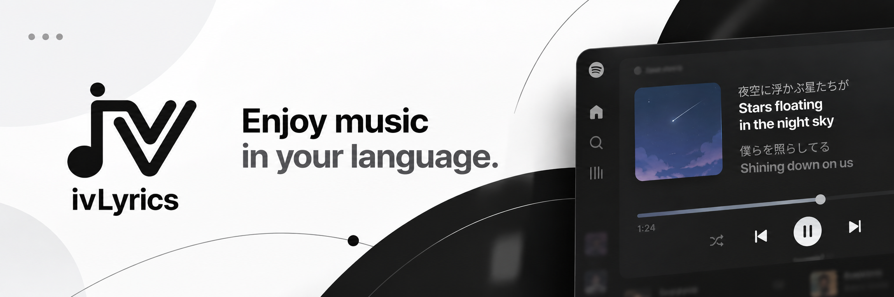

# ivLyrics

Read the lyrics. Sing along. Understand the song.

ivLyrics brings original lyrics, pronunciation, and translation together inside Spotify on your PC. Keep a simple lyrics screen, switch to fullscreen or a vinyl layout, or add an album-art or video background.

[Full guide](https://github.com/ivLis-Studio/ivLyrics#readme) · [한국어 안내](https://github.com/ivLis-Studio/ivLyrics/blob/main/README.md) · [English guide](https://github.com/ivLis-Studio/ivLyrics/blob/main/README_EN.md) · [Get help](https://discord.gg/2fu36fUzdE)


## What you can do

- Follow synced lyrics and karaoke highlighting when timing is available.
- Display original lyrics, pronunciation, and translation in the combination you prefer.
- Add Japanese furigana and adjust each text layer's font, size, and color.
- Choose fullscreen, TV, and vinyl layouts, backgrounds, and motion effects.
- Adjust a song's lyric or video timing and use community sync data.
- Explore optional cultural explanations, Research, and Learning features with a compatible AI provider.

Lyrics, timing, video, and AI capabilities vary by song and provider. AI output can be incorrect.

## Install on your PC

You need the **Spotify desktop app and [Spicetify](https://spicetify.app/docs/getting-started)** on Windows, macOS, or Linux. Restart your terminal if you just installed Spicetify.

On Linux, also prepare Bash, `curl`, `unzip`, and either `sha256sum` or `shasum` for file verification.

**Windows — PowerShell**

```powershell
iwr -useb https://raw.githubusercontent.com/ivLis-Studio/ivLyrics/main/updater/install.ps1 | iex
```

**macOS / Linux — Terminal**

```bash
curl -fsSL https://raw.githubusercontent.com/ivLis-Studio/ivLyrics/main/updater/install.sh | bash
```

These commands run the official repository's installer. Inspect the [Windows](https://github.com/ivLis-Studio/ivLyrics/blob/main/updater/install.ps1) or [macOS / Linux](https://github.com/ivLis-Studio/ivLyrics/blob/main/updater/install.sh) script first if you prefer. Use the same command to update. For a manual install, download `ivLyrics.zip` from the [latest release](https://github.com/ivLis-Studio/ivLyrics/releases/latest) and follow the [full guide](https://github.com/ivLis-Studio/ivLyrics/blob/main/README_EN.md#get-started).

## Play your first song

1. Reopen Spotify and select **ivLyrics** in the sidebar.
2. Follow the first-run language, appearance, and playback guide.
3. Play a song. Open settings from the on-screen menu to make the text and background comfortable.

You do not need to configure every option before listening. Settings search helps you find a specific control later.

## Add translation or pronunciation

Choose your output language in **General → Language**. Then open **AI Providers**, configure a connection if required, and enable the capabilities you want.

**Translation and pronunciation are separate.** Google Translate and Bing Translate support translation only; pronunciation requires a compatible AI provider. You do not need a Gemini key for every feature.

**Local AI** is an optional, translation-only provider that runs on your device. It is off by default and requires a large model download and enough memory. Move it above other translation providers to try it first, or disable online translation providers for local-only translation processing. Online providers can charge for usage and receive the text needed to process your request; check their limits and terms before enabling them.

## Which other apps do I need?

For the basic PC lyrics screen, no companion app is required.

- [Android](https://github.com/ivLis-Studio/ivLyrics-Android) and [iOS](https://github.com/ivLis-Studio/ivLyrics-IOS) have separate installation guides; the PC commands above are not for phones.
- [Overlay](https://github.com/ivLis-Studio/ivLyrics-overlay) keeps lyrics above other desktop windows.
- [Helper](https://github.com/ivLis-Studio/ivLyrics-helper) is optional for video playback assistance and external integrations.

## Need help or want to remove it?

Check enabled **Lyrics Providers** if a song has no lyrics. For AI problems, check the provider key, model, supported capabilities, and usage limits. Try another song to see whether the problem is song-specific.

The [full guide](https://github.com/ivLis-Studio/ivLyrics/blob/main/README_EN.md) includes updates, uninstall commands, and troubleshooting. Export settings before resetting or removing the app.

Report issues on [Discord](https://discord.gg/2fu36fUzdE) or [GitHub](https://github.com/ivLis-Studio/ivLyrics/issues) with your versions, song link, and reproduction steps. Remove API keys and account tokens from screenshots and logs.

[Support development](https://buymeacoffee.com/ivlis) · [Credits and license](https://github.com/ivLis-Studio/ivLyrics/blob/main/README_EN.md#support-and-credits)

ivLyrics is an unofficial project and is not affiliated with Spotify. Lyrics, translations, and videos belong to their respective rights holders. See the [full usage notice](https://github.com/ivLis-Studio/ivLyrics/blob/main/README_EN.md#support-and-credits) before using or sharing content.

## License and open-source notices

The ivLyrics source code is licensed under the [GNU LGPL v2.1](https://github.com/ivLis-Studio/ivLyrics/blob/main/LICENSE). See the README for [third-party notices and the ivLyrics server access policy](https://github.com/ivLis-Studio/ivLyrics/blob/main/README_EN.md#license-and-open-source-notices).
